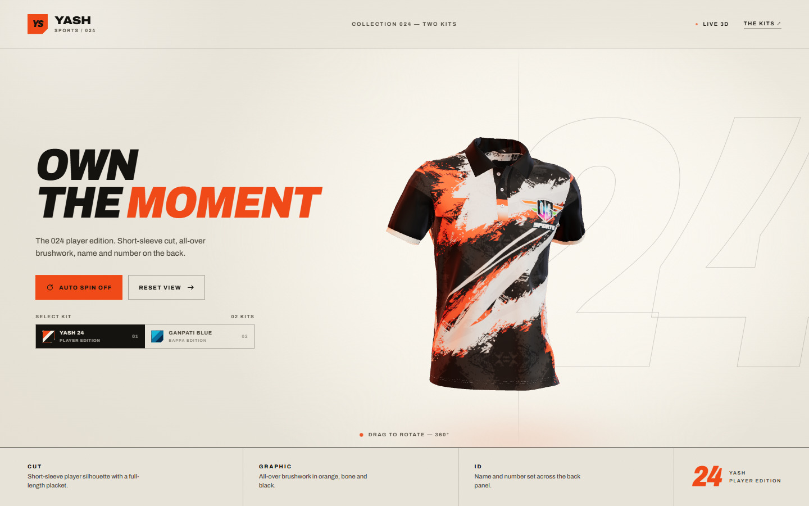

# YASH SPORTS — 3D Jersey Collection

Three Yash Sports jerseys in one interactive kit room. The models are real objects, not video: drag, swipe, or use the arrow keys to study the cut, the print, and the back.



## The kits

- **YASH 24 — Player Edition.** Short-sleeve player silhouette with a full-length placket, all-over orange, bone and black brushwork, and a name-and-number back panel.
- **Ganpati Blue — Bappa Edition.** Round neck, short sleeves with a contrast cuff band, a cyan-to-navy diagonal wash, a front YASH SPORTS crest, Ganpati artwork, and `श्री गणपती बाप्पा मोरया` across the back.
- **SLHS 24 — Xavier Edition.** Short-sleeve school polo with a contrast cream shoulder yoke, a deep maroon marbled wash, the St. Xavier's 50-year mark and crest, and `MHATRE 24` across the back.

YASH 24 is the default. The Ganpati and SLHS kits are fetched only when they are selected or hovered in the kit picker, so the first paint stays light. The Ganpati Devanagari watermark uses a 13 KB self-hosted subset that is not requested until the kit is active.

## What's inside

- **Real rotation, not a video** — drag or swipe to spin a jersey with inertia, drag vertically to tilt it, and use the arrow keys when the 3D stage is focused.
- **Damped auto-spin** — the jersey turns slowly on its own, reveals the back print, and pauses whenever you grab it. The preference carries across kit switches.
- **Three-kit switcher** — an editorial kit rail below the actions. Switching resets the view to the new kit, preserves auto-spin, and shows a quiet load status if the model is not already cached.
- **Layered motion** — intro rise + camera dolly on every kit change, idle bob, pointer parallax, and a small cursor-led tilt.
- **Reduced-motion aware** — auto-spin turns itself off, decorative motion is removed, and the toggle is disabled when the OS asks for it.
- **Responsive art direction** — a light "kit room" editorial layout: bone paper, safety orange, an oversized outlined numeral or Ganpati glyph, self-hosted Archivo variable type, and a Devanagari display accent.
- **Asset pipeline included** — the supplied Blender cloth bake and GLB sources are rebuilt into web models with resized textures and Meshopt-compressed geometry.

## Run it

```bash
npm install
npm run dev
```

| Command | Does |
| --- | --- |
| `npm run dev` | Start the Vite dev server |
| `npm run build` | Type-check and build to `dist/` |
| `npm run preview` | Serve the production build locally |
| `npm run lint` | Lint the project |
| `npm run export:yash` | Bake the draped YASH 24 pose from Blender into `.cache/yash24-draped.glb` |
| `npm run optimize:yash` | Rebuild the YASH 24 web model from the baked GLB |
| `npm run optimize:ganpati` | Rebuild the Ganpati Blue web model from `models/GanpatiBlue_roundNeckJersey.glb` |
| `npm run optimize:slhs` | Rebuild the SLHS 24 web model from the draped YASH pose + `models/SLHSrender.glb` |
| `npm run optimize:all` | Rebuild all three web models |

`npm run export:yash` needs Blender 5.x on `PATH` (or point it at `blender.exe` directly). The other commands only need Node.

## Design showcase — one template, many designs

Open `/?mode=designs` for the scalable design viewer. The default 3-kit experience at `/` is unchanged.

Instead of baking every design into its own GLB, the showcase uses **one** `public/models/jersey-template.glb` and swaps the artwork at runtime:

- `MainJersey` → `JerseyFabric` material receives the active design texture.
- `EndSleeves` → `SleeveTrim` material receives the design's accent colour.
- `CollarTrim` → solid material split out of the textured mesh, also receives the design's accent colour (no more black collar).
- `JerseyButtons` keeps its own solid material.

Build the template, UV guide and demo designs (no Blender required):

```bash
npm run build:template
```

That script reads `public/models/jersey-yash24.glb`, splits its three material primitives into the named meshes above, adds a checker placeholder texture, and writes:

| Output | Purpose |
| --- | --- |
| `public/models/jersey-template.glb` | the single reusable template |
| `public/templates/jersey-uv-guide.png` | real UV islands over the design canvas, with bleed/safe-area guides |
| `public/designs/<category>/<id>.webp` | 1400px full design textures |
| `public/designs/<category>/<id>-thumb.webp` | 360px lazy grid thumbnails |
| `public/designs/manifest.json` | design metadata consumed by the viewer |

**Adding a design:** drop a UV-aligned WebP plus its thumbnail into `public/designs/<category>/` and add one entry to `public/designs/manifest.json`. No Blender, no new GLB. The grid paginates at 24 designs per page and only the active texture (plus immediate neighbours) is ever loaded into WebGL.

## Model pipeline

The untouched source assets live in `models/` and are never loaded by the site.

**YASH 24 → 5.67 MB** (`public/models/jersey-yash24.glb`)

1. Opens `models/3D Mockup Template - Copy.blend`, whose cloth motion is driven by `Animation Cache.abc`, and samples frame 50 — a settled pose with the sleeves hanging down.
2. Bakes that evaluated frame to a static mesh and normalizes it to 3.3 units tall with the hem at `Z=0`.
3. Assigns the three web materials (`Main Design`, `Button Colour`, `Sleeve End Colour`) and applies the 4096×3914 JPEG design texture extracted from the original sleeves-out web model (`models/yash24-texture.jpg`).
4. Optimizes the baked GLB with dedup, prune, texture recompression, and high-level Meshopt compression (24.7 MB → 5.67 MB).

The template's 956 MB Alembic cache must stay next to the `.blend`; it is only needed when re-baking, never by the site. The previous sleeves-out pipeline has been retired, and `models/jersey3dmockup.glb` is kept as an archive of that source.

**Ganpati Blue → 6.64 MB** (`public/models/ganpati-blue.glb`)

1. Strips the nine `Stitching` primitives — roughly 1.4 M of the source's 1.79 M triangles are invisible seam geometry at web scale.
2. Deduplicates and prunes orphaned accessors.
3. Resizes the embedded 8209×8125 PNG to a 4096×4054 JPEG at quality 90.
4. Applies high-level Meshopt compression: six primitives, 211,494 vertices, one texture.

**SLHS 24 → 5.21 MB** (`public/models/slhs.glb`)

1. Starts from the settled YASH 24 draped bake — the SLHS source is the same 427,302-vertex jersey mesh, but its sleeves are still in the flat T-pose.
2. Swaps the YASH main texture for the 4267×4267 SLHS design and carries the SLHS material colours (buttons, cuff trim) across.
3. Resizes the texture to a 4096×4096 JPEG at quality 90.
4. Deduplicates, prunes, and applies high-level Meshopt compression (30.4 MB design source → 5.21 MB).

That keeps the initial page payload at the 5.67 MB YASH asset. The YASH model is preloaded from `index.html` so its download overlaps boot; the Ganpati and SLHS models are fetched on intent. Meshopt is decoded by Drei's `useGLTF`, so no extra runtime setup is required.

## Structure

```text
src/components/JerseyExperience.tsx  page shell, loader, kit switching, drag/keyboard input, UI state
src/components/JerseyScene.tsx       Canvas, responsive camera rig, studio lights/environment
src/components/Jersey.tsx            GLTF loading, material tuning, animation loop
src/lib/kits.ts                      all kit definitions: model, framing, copy, specs, switcher metadata
src/lib/spin.ts                      shared rotation types and state factory
src/lib/designs.ts                   design manifest loader and JerseyDesign type
src/lib/designTextures.ts            small texture cache, neighbour preload, disposal
src/components/TemplateJersey.tsx    one GLB, cloned materials, runtime texture + accent swap
src/components/DesignShowcase.tsx    single WebGL viewer + lazy, paginated design grid
src/design-showcase.css              showcase-only visual system
src/App.css                          visual system, kit rail, responsive rules, reduced-motion overrides
scripts/build-jersey-template.mjs    Blender-free template, UV guide and demo design builder
scripts/export-yash-draped.py          Blender bake: frame 50 of the cloth cache, normalized and textured
scripts/optimize-yash-draped.mjs       YASH 24 texture + Meshopt asset pipeline
scripts/optimize-ganpati.mjs           Ganpati stitching removal + texture + Meshopt pipeline
scripts/optimize-slhs.mjs              SLHS texture swap onto the draped YASH pose + Meshopt pipeline
public/models/                       web-ready models used by the site
public/fonts/                        self-hosted Archivo variable fonts + Devanagari subset
```

## Interaction and accessibility

- Drag (mouse or touch) anywhere on the stage to rotate; release to hand momentum back to the scene.
- Tab to the 3D stage and use the arrow keys to rotate. The stage has a descriptive `aria-label`.
- The kit picker uses real buttons with `aria-pressed`; the active kit is also reflected in the page title.
- `AUTO SPIN` and `RESET VIEW` are real buttons, not canvas hit areas. Double-clicking the stage also resets the view.
- `prefers-reduced-motion: reduce` disables auto-spin, decorative motion, and the spin toggle.
- Inactive models are preloaded on hover/focus of their kit button, so keyboard users get the same head start as pointer users.

## Notes

- Copy only describes what is visible on the supplied kits — no fabric, performance, or manufacturing claims.
- The YASH 24 pose is a static bake of the supplied cloth simulation at its settled frame, so the sleeves hang naturally but do not animate.
- The models are hollow garments, so the inner surface can be seen briefly through a collar or cuff while they rotate.
- Production builds are fully static and can be deployed to any static host. Serve `.glb` and `.woff2` assets with long-lived cache headers for the best repeat-visit experience.
